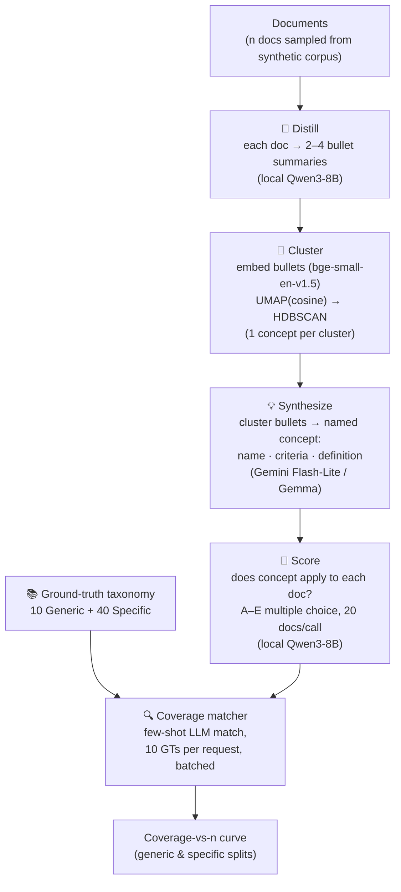
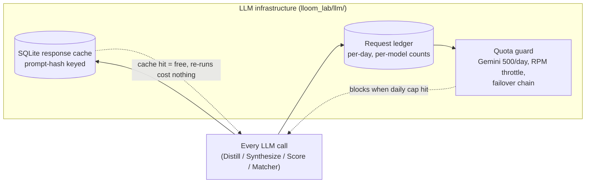
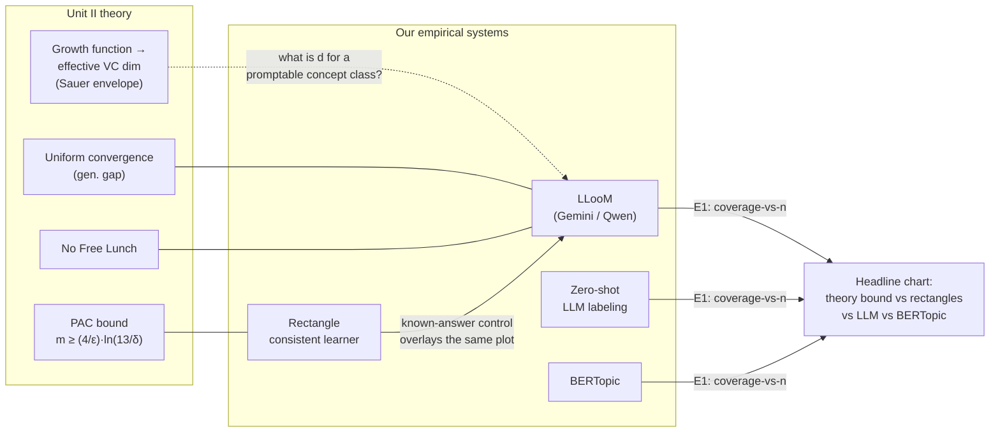
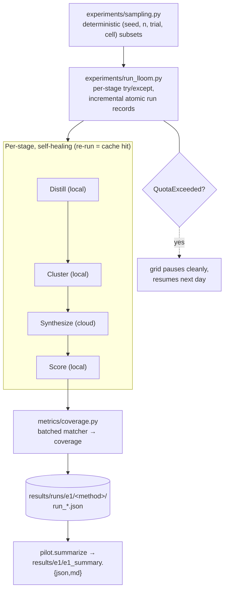

# Project Guide — "How Many Examples Does It Take?"

> An empirical sample-complexity and capacity study of LLM concept induction,
> for the Advanced ML course (Unit II: PAC learning, sample complexity, VC
> dimension, uniform convergence, No Free Lunch).
>
> **Other entry points:** [PROJECT_STATE.md](PROJECT_STATE.md) (status & journal — source of truth) ·
> [Paper.md](Paper.md) (full LLooM paper breakdown) · [REPORT.md](REPORT.md) (progress report) ·
> [CONTRIBUTING.md](CONTRIBUTING.md) (dev workflow) · [lloom-lab/](lloom-lab/) (the code)

---

## 1. Short summary

Topic models like LDA and BERTopic discover *words that co-occur*; **LLooM**
(Lam et al., CHI 2024) goes a step further and induces *human-readable concepts*
— named, defined, criteria-checked patterns — from unstructured text using an
LLM pipeline (Distill → Cluster → Synthesize → Score). The paper shows LLooM
beats BERTopic by +17.9% coverage on Congressional bills, but it never asks the
question every PAC-learning student is trained to ask:

> **How many examples does concept induction actually need?**

That is this project. We build a controlled synthetic corpus where ground truth
is exact *by construction*, run LLooM (and baselines) on subsets of increasing
size n, measure how often the induced concepts cover the hidden ground truth,
and read the resulting coverage-vs-n curve through the lens of classical
learning theory: PAC sample-complexity bounds, the growth function, effective
VC dimension, uniform convergence, and No-Free-Lunch collapse on permuted labels.

## 2. What our project does (end to end)

1. **Build a synthetic corpus with exact labels** — 160 political documents
   (4 cells: length 5/10 sentences × prevalence 20/40% × 40 docs) generated
   from 382 hand-written sentences over the paper's Appendix C.4 taxonomy
   (10 Generic + 40 Specific concepts). Zero API calls, labels exact by
   construction, no pre-training memorization risk. Plus 10 No-Free-Lunch
   variants via label-level derangements (zero fixed points).
   **Where:** `lloom-lab/data_store/synthetic_v1/` — the corpus is
   `docs.jsonl` (one JSON object per line: `doc_id` like `5sent_20prev_000`,
   `text`, `doc_length`, `prevalence`, and exact ground truth under
   `concepts.specific` / `concepts.generic`), the build parameters and
   taxonomy under `manifest.json`, and the NFL variants as
   `nfl/<seed>.json`. Rebuild any of it from seeds with `build-dataset`
   (nothing here is hand-edited or git-irreplaceable).
2. **Re-implement mini-LLooM** on a free-tier budget: Distill and Score run on
   a local Qwen3-8B (llama.cpp), Synthesize on Gemini Flash-Lite, clustering
   with local bge-small embeddings + UMAP → HDBSCAN. Every LLM call is
   cache-first (SQLite, prompt-hash keyed) behind a daily quota ledger.
   **Where:** `lloom-lab/src/lloom_lab/pipeline/`; one self-contained run
   record per (method, n, trial) lands in `lloom-lab/results/runs/e1/<method>/`
   as JSON with the config, docs used, induced concepts, scores, ground truth
   and any stage errors embedded.
3. **Measure coverage honestly** — a batched few-shot matcher (paper §5.1)
   scores induced concepts against ground truth; the matcher itself was
   validated on hand-labeled pairs (reliable on specific concepts,
   over-matches broad generic ones → specific coverage is the primary signal).
   **Where:** `lloom-lab/src/lloom_lab/metrics/coverage.py`; validation pairs
   and report in `lloom-lab/results/pilot/matcher_validation_{pairs,report}.json`.

   **What counts as a match?** The validator follows the *exact-meaning*
   standard: a generated concept counts as covering a ground truth only if it
   is a genuine paraphrase of it — same idea, same granularity. For example,
   an induced concept like "Tax and Ballot Decisions" **is** a match for the
   ground truth "Taxes", but "Skilled Worker Priorities" is **not** a match
   for "Immigration" (a narrow sub-topic, not the same concept), and
   "Election Campaigns" is **not** covered by an induced "Voter and Campaign
   Activity" umbrella (superset ≠ paraphrase). Paraphrase = 1;
   subset / superset / umbrella = 0. This strictness is what exposed the
   matcher's systematic over-matching of broad generic concepts.
4. **Run the experiment suite E1–E5** (Section 4 below) comparing LLooM-Gemini,
   LLooM-Qwen, zero-shot LLM, and BERTopic against theory baselines.
   **Where:** drivers in `lloom-lab/src/lloom_lab/experiments/`
   (`e1.py` etc.); aggregated outputs in `lloom-lab/results/e1/` as
   `e1_summary.{json,md}`; E5 variants consumed from
   `data_store/synthetic_v1/nfl/`.
5. **Deliver**: publication-style charts, a Streamlit live demo, a written
   report mapped to Unit II, and a presentation deck.
   **Where:** final figures in `lloom-lab/charts/` (PNG), the dashboard as a
   Streamlit app (Phase 5), the written report and deck at the repo root.

**The finished project produces:** E1 coverage-vs-n curves for all five
methods on the headline chart, the E2 rectangles-vs-PAC-bound overlay, the
E3 growth function / effective-VC-dim estimate with the Sauer envelope, the
E4 generalization-gap plot, E5 NFL-collapse curves, a Streamlit dashboard
that re-runs the pipeline live (from cache — rehearsals are free), and a
Unit-II-mapped written report and deck. Everything runs from cached LLM
responses, so the entire analysis is reproducible without spending quota.

### The pipeline we run (mini-LLooM)



Every stage is wrapped in the same infrastructure:



## 3. Tech stack

| Layer | Choice | Notes |
|---|---|---|
| Language | Python 3, src-layout package (`lloom-lab/`), installable via `uv pip install -e "lloom-lab[dev]"` | shared supervenv |
| LLM — cloud | **Gemini Flash-Lite** (`gemini-flash-lite-latest`, free tier, 500 req/day) | the "smart" Synthesize + matcher calls; failover to `gemini-3.1-flash-lite`, optional Gemma |
| LLM — local | **Qwen3-8B Q4_K_M** via llama.cpp `llama-server` (OpenAI-compatible, port 8123) | GTX 1650, 4 GB VRAM, `-ngl 25` partial offload; handles high-volume Distill + Score |
| Embeddings | **fastembed `bge-small-en-v1.5`** (local, free) | replaces the paper's ada-002 |
| Clustering | **UMAP (cosine) → HDBSCAN** (scikit-learn 1.9); **BERTopic** as E1 baseline | UMAP-first recipe won in the offline harness (topic recovery 0.66 vs 0.40 raw) |
| Storage | **SQLite** — `results/llm_cache.sqlite3` (prompt-hash → response), `results/request_ledger.sqlite3` (quota) | cache-first invariant: re-runs are free |
| Theory/experiments | NumPy/SciPy-style offline modules (`theory/rectangles.py`, `theory/vc.py`), matplotlib charts | zero-API, fully tested |
| UI | Streamlit dashboard (Phase 5) | live demo |
| Quality | 73 offline pytest tests (fake-based, no network), ruff, GitHub Actions CI | live tests behind `@pytest.mark.live` |
| Secrets | `.env` with `GEMINI_API_KEY` (gitignored), auto-loaded by `config.py` | never printed or committed |

### Per-operator model routing (the cost model)

| Operator | Model | Rationale |
|---|---|---|
| Distill | Qwen3-8B (local) | highest volume — keep off cloud quota |
| Cluster | bge-small + UMAP/HDBSCAN | local & free |
| Synthesize | Gemini Flash-Lite (Gemma arm for volume) | the "smart" call |
| Score | Qwen3-8B (local), 20 docs/call | paper's costliest step (~80% of total cost) |

## 4. Core theory → our experiments

The project is a bridge between the course's Unit II theory and a modern LLM
system. Each classical concept gets a concrete experiment:

| Course concept | What it says | How we test it | Where |
|---|---|---|---|
| **PAC sample complexity** | A consistent learner needs m ≥ (4/ε)·ln(13/δ) examples (axis-parallel rectangles, Mitchell) | E2: run the rectangle consistent learner at increasing m; empirical failure rate vs the bound | `theory/rectangles.py` |
| **Growth function / shattering** | Π_H(m) counts dichotomies a hypothesis class can realize | E3: exact realizability tests → growth function of the concept class | `theory/vc.py` |
| **VC dimension & Sauer's lemma** | Π_H(m) ≤ (em/d)^d; VC dim = largest shattered set | E3: effective VC dim where shatter rate ≥ 0.5, checked against the Sauer envelope. Tests encode textbook answers (thresholds VC=1, intervals VC=2, rectangles VC=4 via the diamond) | `theory/vc.py` |
| **Uniform convergence** | With enough samples, empirical error converges to true error uniformly over H | E4: empirical vs held-out generalization gap of LLooM's Score operator as n grows | `experiments/` (E4) |
| **No Free Lunch** | No learner beats random guessing off-distribution | E5: coverage collapses on label-derangement variants (10 built, zero fixed points) | `data/nfl.py` |
| **Coverage-vs-n** (the headline) | Does concept induction behave like a sample-complexity curve? | E1: coverage for n ∈ {10,20,40,80,160} × 5 methods (LLooM-Gemini, LLooM-Qwen, zero-shot ×2, BERTopic) × 5 trials; specific coverage primary | `experiments/e1.py` |



**What the headline chart shows:** all four systems on one coverage-vs-n
plot — the PAC bound, the rectangle consistent learner (known-answer
control), the LLM-based methods, and BERTopic. Pilot data already indicates
the LLM curves grow with n and then plateau (~0.30–0.35 specific, ~0.70–0.75
generic by n=50–100) — exactly the shape the full E1 grid measures properly.
The pilot's first NO-GO was a clustering-recipe problem, not a dead research
question; the fix (UMAP-first, one concept per cluster) is institutionalized
in an offline harness that scores clustering changes with zero API calls
before any re-run.

## 5. How an experiment flows



Failure containment is deliberate: a Distill failure becomes a marker bullet,
a Synthesize failure skips its cluster, a Score failure counts as non-match —
and any crashed run resumes from the cache with zero lost quota (proven when
llama-server died mid-grid).

## 6. Paper references

**Primary source paper**

- Michelle Lam, Alice Qian, Sherry Wu, Carlos Scheidegger, Wesley Willett,
  Jane Hoffswell, Kenneth C. Li, Anna H. Yang, Negar Kiyavash, James A. Landay,
  Tovi Mensch, Dominik Moritz, and Hendrik Strobelt. *Concept Induction:
  Analyzing Unstructured Text with High-Level Concepts Using LLooM.*
  CHI 2024. [arXiv:2404.12259](https://arxiv.org/abs/2404.12259).
  Local copy: `Concept Induction-Analyzing Unstructured Text with High-Level.pdf`;
  our full breakdown: [Paper.md](Paper.md) with 16 extracted figures in `images/`.

**Key parts of the paper we build on**

- §3 algorithm: Distill / Cluster / Synthesize / Score / Loop (we implement all but Loop).
- §5.1 + App. A.5: the few-shot coverage matcher (we batch 10 GTs/request).
- §5.2 + App. C.4: the synthetic-politics dataset and its 10 Generic + 40
  Specific ground-truth taxonomy (we replicate it verbatim with hand-written sentences).
- Headline results for comparison: +17.9% coverage vs BERTopic on Congressional
  bills; matcher MAE ≈ 0.07 on 16 trials; ≈ $1.44 per full run (GPT-4 pricing).

**Theory and tools referenced**

- M. Kearns & U. Vazirani, *An Introduction to Computational Learning Theory* —
  PAC learning, sample complexity (course Unit II backbone).
- T. Mitchell, *Machine Learning* — the axis-parallel-rectangle PAC bound m ≥ (4/ε)·ln(13/δ) (E2).
- Sauer's lemma and VC dimension — standard references (Vapnik & Chervonenkis; Shalev-Shwartz & Ben-David, *Understanding Machine Learning*) for the E3 envelope.
- L. McInnes et al., *UMAP* (arXiv:1802.03426); Campello et al., *HDBSCAN* (PAKDD 2013) — the clustering stack.
- Grootendorst, *BERTopic* (arXiv:2203.05794) — the E1 baseline topic model.
- fastembed / BAAI `bge-small-en-v1.5` — local embedding model replacing ada-002.

## 7. Repo map (where to look)

```
AML-Project/
├── GUIDE.md / README.md / REPORT.md     ← you are here; status; progress report
├── PROJECT_STATE.md                     ← source of truth (status, TODOs, journal)
├── Paper.md + images/fig1…16            ← LLooM paper breakdown + PDF figures
└── lloom-lab/
    ├── src/lloom_lab/
    │   ├── config.py                    ← ALL paths/models/quotas (+ .env auto-load)
    │   ├── llm/                         ← unified client, SQLite cache, ledger
    │   ├── pipeline/                    ← mini-LLooM: distill → cluster → synthesize → score
    │   ├── data/                        ← taxonomy, sentences, synthetic generator, NFL variants
    │   ├── metrics/                     ← batched coverage matcher
    │   ├── theory/                      ← rectangles (E2), VC/growth function (E3)
    │   └── experiments/                 ← sampling, run driver, pilot, e1
    ├── tests/                           ← 73 offline tests (CI gate)
    ├── scripts/                         ← smoke tests, build_dataset, run_pilot, run_e1,
    │                                      validate_matcher, cluster_harness, start_qwen_server.bat
    └── results/                         ← run records, pilot/e1 summaries, cache DBs (gitignored)
```

## 8. Quick start

```bash
uv pip install --python C:/Users/Admin/Projects/.supervenv/Scripts/python.exe -e "lloom-lab[dev]"
cp .env.example .env          # add GEMINI_API_KEY
cd lloom-lab && pytest -m "not live"      # offline suite, no API needed
# experiments (all cache-resumable, quota-guarded):
python scripts/run_pilot.py               # GO/NO-GO pilot grid
python scripts/run_e1.py                  # E1 coverage-vs-n grid
```

Rules that keep the project cheap and reproducible: **cache-first** (never call
an LLM outside `config.make_client()`), **quota-guarded** (Gemini 500/day hard
stop, RPM throttling, failover chain), **config centralized** in
`lloom_lab/config.py`, high-volume calls always local. Full rules in
[CONTRIBUTING.md](CONTRIBUTING.md).
