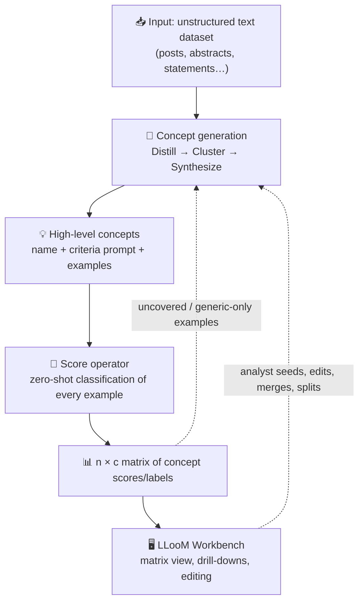
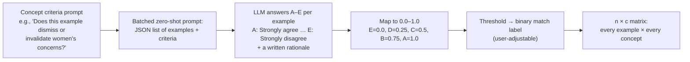
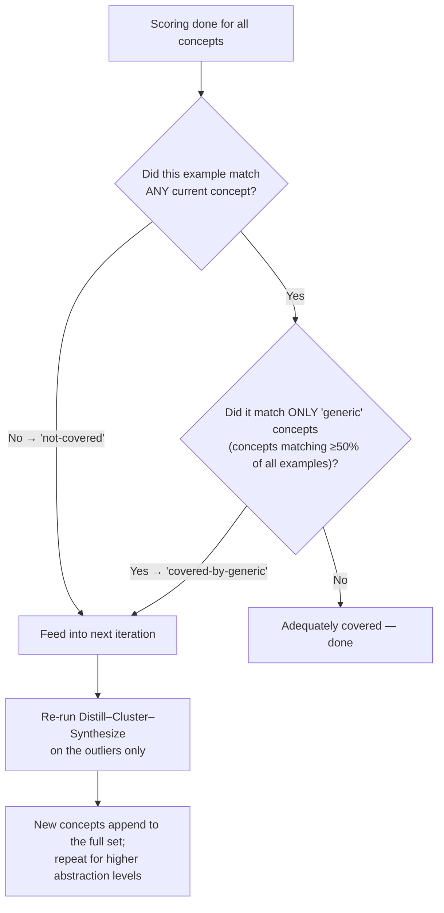
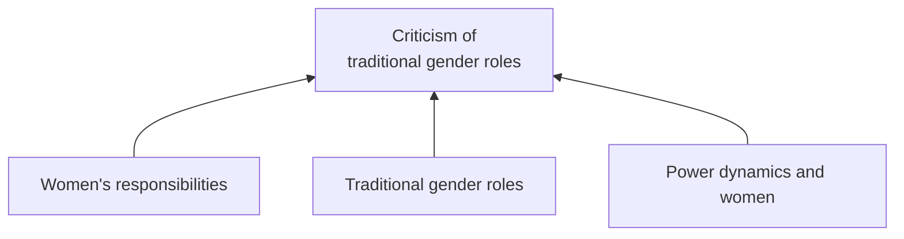

# 📄 Concept Induction: Analyzing Unstructured Text with High-Level Concepts Using LLooM

> **A complete, plain-English breakdown of the paper** — what problem it solves, how the algorithm works step by step, what the tool looks like, every evaluation and its numbers, limitations, and how you could actually use it.

| | |
|---|---|
| **Paper** | Concept Induction: Analyzing Unstructured Text with High-Level Concepts Using LLooM |
| **Authors** | Michelle S. Lam, Janice Teoh, James A. Landay (Stanford University) · Jeffrey Heer (University of Washington) · Michael S. Bernstein (Stanford University) |
| **Venue** | CHI 2024 (ACM Conference on Human Factors in Computing Systems), May 11–16, 2024, Honolulu, HI |
| **arXiv** | [arXiv:2404.12259](https://arxiv.org/abs/2404.12259) [cs.HC], v1 posted 18 Apr 2024 |
| **DOI** | [10.1145/3613904.3642830](https://doi.org/10.1145/3613904.3642830) |
| **Code** | [github.com/michelle123lam/lloom](https://github.com/michelle123lam/lloom) — Python package + Jupyter widget |
| **Field** | Human-Computer Interaction (HCI) · NLP · Human-AI interaction · Data visualization |
| **Models used** | GPT-4, GPT-3.5-Turbo, OpenAI `text-embedding-ada-002`, (optionally) Google PaLM `chat-bison-001` |
| **One-liner** | Replace keyword-level "topics" with human-readable *concepts* ("Dismissal of women's concerns") that come with their own classification rules, then let analysts steer, edit, and reuse those concepts in an interactive tool. |

---

## 📌 TL;DR (30-second version)

- **The problem:** Topic models like LDA and BERTopic give you keyword blobs — *"women, power, female"*, *"feminists, feminism, feminist"*, or junk like *"morning, snoring, sir"*. A human still has to do all the hard interpretive work of deciding what these clusters actually *mean*.
- **The idea:** The authors define a new task, **concept induction**: automatically extract *high-level concepts* from raw text. A concept = a human-interpretable **name** + an explicit **inclusion criterion** written as a question (e.g., *"Does the example dismiss or invalidate women's fears, concerns, or experiences?"*) + representative examples + a 0–1 **score** for every item in the dataset.
- **The method (LLooM):** An iterative pipeline of LLM-powered operators — **Distill → Cluster → Synthesize** to *generate* concepts, **Score** to apply them back to all data, and **Loop** to re-run on anything left uncovered. It mimics qualitative coding (open coding → grouping → theme formation → recoding) with LLMs doing the labor.
- **The tool (LLooM Workbench):** A Jupyter-embedded interactive matrix (concepts × data slices) where analysts can inspect, add, edit, merge, and split concepts — a *mixed-initiative* workflow.
- **The results:** LLooM recovers ground-truth topics better than BERTopic and even zero-shot GPT-4/GPT-4-Turbo on unseen data (+17.9% coverage on Congressional bills), is dramatically better at finding *nuanced, specific* concepts (+16.0% on synthetic data, p < .0001), scores text about as reliably as a second human annotator (Cohen's κ ≈ 0.63 vs. human-human 0.64), and in expert case studies helped two researchers who *already knew their datasets* discover patterns they had missed (e.g., "attacks on out-party stances" in political posts).
- **Cost reference:** one full run ≈ **$1.44**, ~848K tokens, ~13.7 minutes (as of 2024 API prices).

---

## 1. 🎯 The Problem: Why Topic Models Aren't Enough

### 1.1 The status quo

Much of the world's information is unstructured text — social media posts, paper abstracts, support tickets, historical archives. The standard tools for making sense of it at scale are:

- **LDA (Latent Dirichlet Allocation)** — classic topic modeling: documents are distributions over topics; topics are distributions over words, learned from word co-occurrence.
- **BERTopic-style clustering** — embed text with a language model (e.g., BERT / Sentence-BERT), reduce dimensionality, cluster (e.g., HDBSCAN), and label each cluster with keywords (c-TF-IDF).

These are ubiquitous in social science and medicine — used to study research trends, political polarization, public health measures, media framing, and more.

### 1.2 Where they fall short

| Failure mode | Example from the paper |
|---|---|
| **Low-level, keyword-bound topics** | On a misogyny dataset, BERTopic outputs *"women, power, female"* and *"feminists, feminism, feminist"* — on-topic but too generic to answer *"How are women in power described?"* or *"What arguments are levied against feminists?"* |
| **Text similarity ≠ human judgment** | Term co-occurrence and embedding distances correlate with *surface* similarity, not with what humans consider semantically related. |
| **Junk / incoherent topics** | e.g., *"morning, snoring, sir"*. Analysts have no recourse when input texts land in uninformative groups. |
| **Poor coverage** | Cluster-based models often leave big "uncategorized/outlier" buckets (in the paper's scenarios: 44.4%, 26.2%, 18.6% of examples uncategorized by BERTopic). |
| **Automated metrics mislead** | Recent work shows automatic topic-coherence metrics are poorly aligned with real human quality judgments. |

**The core insight:** what analysts actually need for their real tasks — generating research questions, forming hypotheses, producing insights — are **high-level concepts**, not keyword clusters.

> 💡 **In plain English:** A topic model tells you *which words show up together*. An analyst needs to know *what idea the posts are expressing*. LLooM automates that interpretive bridge.

### 1.3 The paper's headline comparison


*Figure 1 (paper): Left — status quo topic modeling yields keyword clusters ("Feminist, Feminism, Feminists"; "Pay, Paid, Salaries"). Middle — LLooM turns raw text into high-level concepts (Misogynistic Language, Victim Blaming, Dismissiveness, Criticism of Feminism…) across different domains. Right — the LLooM Workbench visualizes concept prevalence across user-defined slices, and every concept carries its own criteria prompt with scored matches.*

Notice the score column: the post *"You're perpetuating that garbage…"* scores **1.0** on "Misogynistic language," while *"What's going on in this country…"* scores **0.0**. Concepts are *operationalized* — they can classify anything, not just describe a cluster.

---

## 2. 🧠 Core Ideas & Definitions

### 2.1 The two central definitions

> **Concept induction** *(the task)*: a computational process that takes an unstructured text dataset as input and produces a set of emergent, high-level concepts as output, each defined by explicit criteria.

> **High-level concept** *(the output unit)*: a human-interpretable description defined by explicit **inclusion criteria** — i.e., a natural-language decision rule for whether any input matches the concept.

Every LLooM concept bundles four things:

1. **A name** (2–4 words by default): e.g., *"Criticism of traditional gender roles"*.
2. **Inclusion criteria** as a zero-shot classification prompt: e.g., *"Does the example critique or challenge traditional gender roles or expectations?"*
3. **Representative examples**: the text spans that best demonstrate the concept.
4. **Concept scores** (0–1) for *every* example in the dataset, thresholdable into binary labels.

### 2.2 Why the criteria matter (the key design stance)

Because a concept *is* a reusable classification rule, you can:

- **Apply it forward** — consistently classify new, unseen data through the same lens.
- **Discover gaps** — score everything and see what *isn't* covered by your current concept set.
- **Stack it** — feed concepts (instead of raw text) back into generation to get *higher-level* concepts.
- **Audit it** — anyone can read the criterion and argue with it. Compare that to a topic model's inscrutable word distribution.

### 2.3 Glossary (all the jargon you'll meet)

| Term | Meaning in this paper |
|---|---|
| **LLooM** | The concept induction algorithm + tool ("LLM-powered concept induction"; the name plays on looping/abstraction levels). |
| **Operator** | A named pipeline step (Distill, Cluster, Synthesize, Seed, Score, Loop). |
| **Distill** | LLM step that compresses each document: exact-quote extraction (**Filter**) then bullet summarization (**Summarize**). |
| **Cluster** | Group the distilled bullet points by embedding similarity (ada-002 + HDBSCAN), detached from their source documents. |
| **Synthesize** | GPT-4 prompt that proposes named concepts + criteria prompts + representative example IDs for a cluster. |
| **Seed** | Optional analyst-provided term (e.g., "social issues") that steers Distill/Synthesize attention. |
| **Score** | Batched zero-shot multiple-choice (A–E) labeling of every example against a concept's criteria prompt. |
| **Loop** | Iteration logic: re-process examples that matched nothing ("not-covered") or only generic concepts ("covered-by-generic"). |
| **Concept prevalence** | Fraction of documents (in a slice) that match a concept. |
| **Slice** | A user-defined subset of the data, via metadata filters (e.g., `toxicity < 0.25`) or other concepts. |
| **Coverage** | Proportion of ground-truth topics/concepts recovered by a method (main quantitative metric). |
| **Generic vs. Specific concepts** | Generic = broad themes (e.g., "Healthcare"); Specific = narrow, nuanced ideas (e.g., "Mental health"). LLooM's edge is Specific. |
| **Mixed-initiative** | Human and AI both drive the workflow: AI proposes, human steers/edits. |
| **Inductive coding** | Building codes *from* the data (qualitative analysis). **Deductive coding** = applying existing codes back to data. LLooM automates both loops. |
| **Grounded theory / open coding / constant comparison** | Qualitative methods LLooM draws inspiration from: line-by-line interpretation, iterative grouping into themes, repeatedly testing codes against data. |
| **Cohen's κ (IRR)** | Inter-rater reliability statistic; 0.64 here means "about as agreeable as two humans." |
| **HDBSCAN** | Density-based hierarchical clustering; chosen because it needs little parameter tuning and can leave points unclustered. |

---

## 3. 🔬 Research Objectives & Contributions

**Stated objective:** enable theory-driven data analysis by transforming unstructured text into high-level concepts that analysts can understand and control — shifting analysts' attention *from interpreting topics* to *engaging with theory*.

**The three contributions:**

1. **The LLooM algorithm** — extracts and applies concepts via LLMs: synthesize sampled text spans → generate criteria-defined concepts → apply them back to data → iteratively generalize to higher levels.
2. **The LLooM Workbench** — a text-analysis tool (computational notebook widget or standalone Python package) for visualizing and interacting with data in terms of concepts.
3. **A multi-part evaluation** — four analysis scenarios, technical benchmarks (real + synthetic data), and expert case studies with the original researchers of two datasets.

**Implicit research questions the evaluations answer:**

- RQ1: Do LLooM's concepts cover real datasets better than a state-of-the-art topic model (BERTopic)? *(§4 scenarios)*
- RQ2: Does the algorithm recover human-annotated ground-truth concepts better than BERTopic *and* raw GPT-4 prompting? *(§5.1–5.2)*
- RQ3: Does automatic concept scoring agree with human judgment? *(§5.3)*
- RQ4: Do expert analysts, on datasets they already published on, find the concepts useful and act on them? *(§6)*

---

## 4. ⚙️ The LLooM Algorithm — Step by Step

### 4.1 Process overview


*Figure 2 (paper): (1) unstructured text → (2) LLM-aided concept generation → (3) high-level concepts with explicit criteria prompts → (4) concept scoring over the full dataset → (5) the LLooM Workbench for mixed-initiative analysis.*



The design explicitly mirrors **qualitative coding**: Distill ≈ line-by-line open coding, Cluster ≈ affinity grouping / axial coding, Synthesize ≈ theme synthesis, Score ≈ deductive coding ("constant comparison"), and the Loop ≈ successive rounds of coding that go broader and more abstract.

### 4.2 Concept generation: Distill → Cluster → Synthesize


*Figure 3 (paper): a full worked pass on political posts. Seed → Distill (filter to excerpts, summarize to bullets) → Cluster (pool + group bullets) → Synthesize (propose "Concerns about National Security", "Energy Solutions"…) → Loop up to higher-level concepts like "Government Accountability" and "Advocacy for Policies".*

#### 🔪 Distill — "shrink the data without losing its soul"

- **Why:** LLM context windows are finite, and datasets are not. Also, raw text carries noise; distillation "zooms" onto salient attributes.
- **Filter step** (gpt-3.5-turbo, temperature 0): extract *exact quotes* from the document (extractive summarization). Skippable for short texts.
- **Summarize step** (gpt-3.5-turbo, temperature 0): compress the quotes into **2–4 bullet points of 5–8 words each** (abstractive summarization).
- **Prompt shape:** `Please summarize the main point of this EXAMPLE {seed_phrase} into {n_bullets} bullet points…` → JSON output.

#### 🧩 Cluster — "regroup the shards"

- All bullet points are **detached from their original documents and pooled together** — this is what enables *cross-cutting* concepts (a pattern that spans many unrelated documents).
- Bullets → embeddings via OpenAI `text-embedding-ada-002` (long context, fast) → clustered with **HDBSCAN** (density-based: minimal tuning, and it's allowed *not* to assign every point, so clusters stay salient instead of being forced).
- Analogy: the affinity-diagramming moment in a qualitative study.

#### 💡 Synthesize — the core novelty (gpt-4)

- Takes a cluster of bullet summaries and asks GPT-4 to propose **unifying patterns**: for each, a 2–4-word **name**, a one-sentence **ChatGPT-style criteria prompt** that could classify a *new* example, and the **IDs of 1–2 representative examples**.
- Uses **chain-of-thought**-style prompting so the model shows its work (improves internal consistency).
- Crucially, the task is framed as **"identify subsets of examples that best exemplify patterns"** — *not* "label this whole cluster." Clusters are noisy; forcing a holistic label yields vague concepts. Selective pattern-finding yields sharp ones.
- Quirk the authors discovered: the word **"pattern"** worked better in the prompt than "concept" (more reliably conveyed "shared among multiple items").
- Why not just ask GPT-4 directly? Direct zero-shot synthesis of a whole corpus produces **broad, generic** concepts ("these posts are feminist-*related*") rather than nuanced ones ("these constitute *men's critiques of feminism*"), and can't exceed the context window. The Distill–Cluster–Synthesize scaffolding fixes both (proven empirically in §5).

#### 🌱 Seed — the analyst's steering wheel (optional)

A user-provided term (inserted as *"related to {seed_term}"*) conditions Distill and/or Synthesize:

- Political dataset → seed "social issues".
- Academic papers → seed "evaluation methods".
- Chat transcripts → seed "displays of emotion".

Rationale: qualitative analysis accepts that data admits multiple valid interpretations; Seed hands the interpretive lens to the analyst.

### 4.3 Concept scoring: Score



- Implemented with **gpt-3.5-turbo** (or Google PaLM `chat-bison-001`), temperature 0, **multiple-choice prompting** — because LLMs asked to emit raw 0–1 confidence numbers are poorly calibrated, but instruction-tuned models' multiple-choice answer distributions approximate probabilities well.
- This is the **deductive coding** half of the qualitative analogy: applying the "codebook" (concepts) back to *all* the data — which also exposes gaps and biases in the concept set.

### 4.4 Iteration: Loop



Because concepts are generated *from concepts* in later iterations, LLooM produces hierarchies: e.g., subconcepts *"Women's responsibilities"*, *"Traditional gender roles"*, and *"Power dynamics and women"* were synthesized up into **"Criticism of traditional gender roles."** Every concept remains unrollable into its auditable trace.

### 4.5 A worked micro-example (synthetic illustration in the paper's style)

| Stage | What happens |
|---|---|
| **Input** | A misogynistic post: *"Women want equality until it's time to register for the draft. Then suddenly it's 'men's work.'"* |
| **Filter** | Quotes extracted: *"equality until it's time to register for the draft"*, *"'men's work'"* |
| **Summarize** | Bullets: `"claims feminists avoid burdens"`, `"invokes draft registration"` |
| **Cluster** | Bullet lands with bullets from ~40 other posts like *"feminists ignore male conscription"* |
| **Synthesize** | GPT-4 proposes: name = **"Perceived feminist hypocrisy"**; criteria = *"Does the example accuse feminists of holding double standards or hypocrisy?"*; representative example IDs = 2 posts |
| **Score** | The original post → "Strongly agree" → **1.0**. A post complaining about game difficulty → "Strongly disagree" → **0.0** |
| **Loop** | Posts about gaming slang that matched nothing → collected for the next iteration → later become a "Gaming culture references" concept |

### 4.6 Implementation details & running costs

| Component | Choice |
|---|---|
| Packaging | Python library; importable in Jupyter notebooks or Flask web apps |
| Distill (Filter + Summarize) | `gpt-3.5-turbo`, temperature 0 |
| Cluster | `text-embedding-ada-002` embeddings + HDBSCAN |
| Synthesize | `gpt-4` (algorithm version); `gpt-3.5-turbo` used in the §4 scenarios for interactivity |
| Score | `gpt-3.5-turbo` or PaLM `chat-bison-001`, temperature 0 |
| Typical run (across the 4 scenarios) | **$1.44**, **848,323 tokens**, **13.7 minutes** |
| Cost/time hot spot | Concept **scoring** = **79.9% of cost**, **58.4% of time** (it touches every example × every concept) |

### 4.7 Acknowledged algorithm limitations

1. **Parameters are hard to preset** (number of quotes, bullets…). Defaults exist but haven't been robustly validated across datasets; ideally the system would tune these dynamically.
2. **No verification steps** — nothing programmatically checks that quotes are exact, bullets are faithful, or scores/rationales are sound. Future work: LLM-based verifier operators.
3. **Run-to-run variability** — LLM nondeterminism means re-runs differ. Great for exploring parallel analysis paths; bad for replication-critical analyses.

---

## 5. 🖥️ The LLooM Workbench


*Figure 4 (paper): (A) Matrix view of concepts × slices with prevalence encoded as circle size; (B) Concept detail view with criteria, subconcepts, histogram, and a scored match table; (C) Slice detail view for a user-defined slice like "Low toxicity".*

### 5.1 The three views

| View | What it shows | Why it matters |
|---|---|---|
| **Matrix view** (A) | Generated concepts as **rows**, user-defined **slices** as columns (default "All"; custom slices = metadata filters like `toxicity < 0.25` or filters on other concepts). Each cell: circle sized by concept prevalence in that slice, normalizable by concept or by slice. | One-glance comparison of a concept across groups (row-wise) or of a group's concept profile (column-wise). |
| **Concept detail view** (B) | Concept name, **criteria prompt**, the **subconcepts** that produced it (auditable lineage), representative examples per subconcept, a prevalence **histogram**, and a **match table** of scored examples (with Filter-step quotes highlighted). | Inspect *meaning* and *evidence* before trusting a concept. |
| **Slice detail view** (C) | Slice name + filter criteria, prevalence histogram, and a table of all matching examples with concept score columns. | "What's in this bucket?" |

### 5.2 Analyst actions (the "initiative" in mixed-initiative)

- **Add / Edit** — author a custom concept by writing a name + criteria prompt; LLooM scores it across the whole dataset and adds it as a matrix row. Existing concepts can be renamed or re-criteria'd and re-scored.
- **Merge** — combine related concepts; the system generates a combined name + criteria.
- **Split** — a concept is too general? The system authors new subconcepts for it.
- **Seed** — steer future generation (§4.2).

### 5.3 Under the hood

Jupyter widget built with **anywidget**, UI in **Svelte**, matrix visualization in **D3**; the widget calls the LLooM Python library (also usable standalone / in Flask).

> 💡 **In plain English:** the Workbench turns the algorithm's output from a one-shot report into a *material you can sculpt* — the concept set is versionable, arguable, and co-owned by you and the model.

---

## 6. 📊 Evaluation 1 — Four Real-World Analysis Scenarios (vs. BERTopic)

### 6.1 Method

- **Baseline:** BERTopic with `text-embedding-ada-002` embeddings + HDBSCAN (min cluster size 2–3% of dataset), keywords via c-TF-IDF. A team member manually labeled every BERTopic topic.
- **LLooM config:** one iteration, ≤200 sampled items, ≤20 concepts, `gpt-3.5-turbo` for distill+synthesize (chosen so a run finishes in **5–15 minutes** with fast scoring, enabling interactive use), match threshold at the most confident option (1.0 "Strongly agree").
- **Fair-overlap methodology:** BERTopic can't express nuanced criteria in keywords, so to avoid penalizing it unfairly, LLooM concepts were conservatively grouped (subsumed or synonymous concepts merged) before computing overlap. Overlap = shared meaning between a BERTopic topic and a (grouped) LLooM concept.

### 6.2 Scenario 1 — Developing moderation policies for toxic content

- **Data:** ~100,000 social media posts (Twitter, Reddit, 4chan) with toxicity ratings from **17,280 U.S. annotators**; zoomed into the feminism-related cluster (**n = 496**).
- **Results:** LLooM generated 10 concept groups (e.g., **Devaluation of men**, **Empowerment of women**, **Gender inequality and discrimination**, plus style/tone concepts like **Expressing frustration** and **Reflection and introspection**). BERTopic produced 8 keyword topics.
- LLooM captured **attitudes and interpretations** beyond surface features; BERTopic stayed at keyword groupings.
- **Numbers:** 50% of BERTopic's results covered by LLooM; 40% of LLooM's covered by BERTopic. **Uncategorized examples: 44.4% (BERTopic) vs. 9.5% (LLooM)** — a massive coverage win.


### 6.3 Scenario 2 — Mitigating partisan animosity on social media

- **Data:** 405 public Facebook posts (via CrowdTangle politics categories), manually coded for partisan animosity (score = sum of 8 sub-scores × 1–3 → range 8–24).
- **Results:** LLooM: 14 concepts — entities and issues (Concerns about National Security, Political Affiliation Mentioned, Advocacy for Policies) **plus user behaviors** (expressions of condolences, mentions of political figures) **and additional issues** (social justice, access to affordable services). BERTopic: 8 topics aligned with entities ("house, republicans, democrats") and issues ("care, vaccine, mandate").
- **Numbers:** 87.5% of BERTopic results covered by LLooM vs. only 50% the other way — a sizeable *novel* LLooM portion. **Uncategorized: 26.2% vs. 2.5%.**


### 6.4 Scenario 3 — Analyzing 30 years of UIST paper abstracts

- **Data:** from an HCI-patent-impact study; UIST had outsized patent citations, so they sampled **n = 210 abstracts**, stratified 70/decade across 1989–1998, 1999–2008, 2009–2018 (from a filtered pool of 1,733).
- **Results:** LLooM: 16 concepts (Gesture Recognition, Visualization Techniques, Sensor Integration… plus the interesting non-overlaps: **Performance improvement**, **Prototype Systems**, **Mathematical Frameworks** — i.e., *methods/evaluation culture*, raising questions about UIST's common metrics vs. other HCI venues). BERTopic: 12 topics; more coherent here than in other scenarios (abstracts signal their subject; keywords like "VR," "haptics" are precise technical terms).
- **Numbers:** 83.3% of BERTopic results covered by LLooM vs. 62.5% reverse. **Uncategorized: 18.6% vs. 6.7%.**


### 6.5 Scenario 4 — Anticipated consequences of AI research (NeurIPS broader-impact statements, in Appendix C)

- **Data:** 300 broader-impact statements (NeurIPS 2020 required them).
- **Results:** BERTopic collapsed everything into **2 generic topics** — one a catch-all ("learning, work, data") swallowing **93.3%** of examples. LLooM produced **14 concepts** spanning positive impacts (**Energy Conservation**, **Efficient ML Algorithms**, **Generalization Improvement**), negative impacts (**Privacy Concerns**, **Adversarial Attacks**), and *proposed mitigations* (**Adversarial Defenses**, **Importance of Verification**).
- **Numbers:** 100% of BERTopic's (two) results overlapped with LLooM; only **14.3%** of LLooM's overlapped with BERTopic. Uncategorized: 0% vs. 9.3%.


### 6.6 Cross-scenario takeaways

| Metric | BERTopic | LLooM |
|---|---|---|
| Avg. uncategorized examples | **77.7% coverage** equivalent (large outlier buckets: 44.4% / 26.2% / 18.6% / 0%) | **93% of examples covered** on average |
| High-quality topic count | baseline | **~2.0× more** high-quality topics |
| Concept expressiveness | keywords only | attitudes, behaviors, styles, mechanisms |

### 6.7 Scenario limitations (self-reported)

Only one LLooM iteration was run (for fairness of comparison); ~200-item samples may not represent much larger datasets (though generated *criteria* can be applied to the full corpus later); no ground-truth concept annotations exist for these datasets, so no global coverage/alignment numbers (that's what §5 adds); results may differ on other data types.

---

## 7. 📈 Evaluation 2 — Technical Evaluations

### 7.1 Benchmark datasets (real-world, human-annotated)

**Datasets** (from prior topic-modeling work):
- **Wiki:** 14,290 Wikipedia articles, 15 generic human topics ("Art and architecture", "Language and literature", …); stratified sample n=205.
- **Bills:** 32,661 U.S. Congressional bill summaries, 28 generic topics ("Education", "Environment", "Health", …); stratified sample n=213.
- **Memorization caveat:** Wiki text-label mappings may exist in GPT's pre-training data (inflating GPT-4 baselines); Bills summaries and labels are stored separately, so it's a more realistic unseen-data test. LLooM also transforms text spans (quotes→bullets) before synthesis, so it "benefits" less from memorization.

**Metric — concept coverage:** fraction of human-annotated ground-truth topics recovered. **10 independent trials × 4 methods × 2 datasets = 80 trials.** Coverage is auto-scored by a GPT-3.5 few-shot matcher (each ground-truth topic ↔ at most one generated concept, exact-meaning matches only, with rationales); verified against manual matching on 16 trials → **MAE = 0.07** (the automated metric is trustworthy).

**Methods compared:** LLooM (GPT-4 Synthesize), BERTopic, **GPT-4 zero-shot**, **GPT-4-Turbo zero-shot** (same synthesis prompt but full documents stuffed into the context window).

**Results:**


| Method | Bills (likely unseen) | Wiki (possibly seen) |
|---|---|---|
| BERTopic | M = 0.29 | M = 0.63 |
| GPT-4 | — | M = 0.83 |
| GPT-4-Turbo | M = 0.56 | M = 0.82 |
| **LLooM** | **M = 0.74** ✅ (+17.9% over best baseline) | **M = 0.81** (statistically tied with GPT-4) |

- Bills: significant method effect (F(3,36)=22.36, p<.001); all pairwise differences significant *except* GPT-4 vs. GPT-4-Turbo (p=0.997); GPT-4-Turbo vs. LLooM p<.02, all others p<.01.
- Wiki: significant method effect (F(3,36)=3.568, p<.05); only BERTopic vs. GPT-4 significant.
- **Robustness:** moving Wiki→Bills, LLooM's coverage drops only **8.7%** while GPT-4-Turbo's drops **25.6%** — consistent with the memorization hypothesis.
- **Qualitative output differences:** BERTopic stays vague ("album, band, music"); GPT-4 matches topics but sometimes *merges* several ground truths into one ("Artistic Works"); LLooM both matches ground truths ("Educational Policies") *and* surfaces sub-nuances within them ("Community Development: …promoting education for community development?"; for Wiki video games: "Video Game Discussion", "Game Setting", "Character Design"; for music: "Band Formation", "Musician's Career").

### 7.2 Synthetic dataset (controlled experiment)

**Why:** experimental control — vary document length and how deeply a concept is buried, while guaranteeing text–label mappings never appeared in pre-training.

**Design:**

| Factor | Levels |
|---|---|
| Topic domain | "politics" (aligns with Bills + Partisan scenarios) |
| Ground-truth concepts | **10 Generic** (e.g., Healthcare, Immigration, Economy) each with **4 Specific** children (e.g., Mental health, Health insurance, Drug policy, Universal healthcare) — 40 Specific total |
| Document length | 5 or 10 sentences |
| Within-document concept prevalence | 20% or 40% of sentences |
| Volume | 40 GPT-4-generated documents per combination (programmatically verified lengths & seed-sentence counts; manual verification of concept presence) |


**Results:**


| Concept type | BERTopic | GPT-4 | GPT-4-Turbo | **LLooM** |
|---|---|---|---|---|
| **Generic** coverage | 0.46 | 0.69 | 0.98 | **0.98** (tied for best) |
| **Specific** coverage | ~0.11 | ~0.37 | 0.55 | **0.71** ✅ (+16.0% over nearest baseline) |

- Specific-concept model: method F(3,154)=227.4, p<.0001; prevalence F(1,154)=22.0, p<.0001 (higher prevalence → higher coverage); length F(1,154)=5.8, p<.05 (longer docs → higher coverage); **all method pairs differ at p<.0001**.
- Generic-concept model: method F(3,154)=115.03, p<.0001; all pairs significant *except* GPT-4-Turbo vs. LLooM.
- **The headline:** everyone can find big umbrella themes; **only LLooM reliably finds the nuanced, specific concepts that analysts actually theorize with** — baselines collapse exactly where it matters most. LLooM yields both "Economic Policies" *and* "Fiscal Measures" / "Economic Stability".

### 7.3 Concept classification — can the Score operator be trusted?

**Design:** sampled 4 concepts per scenario dataset (one per prevalence quartile, 16 total), built balanced n=100 test sets per concept (50 scored-positive / 50 negative; positives = only "Strongly agree" labels — deliberately conservative), and had humans annotate with the *same* A–E options the LLM saw.

**Results:**


- **Overall: accuracy 0.91, precision 0.70, recall 0.59, F1 0.59** — strong accuracy on genuinely hard, subjective, long-text concepts.
- Per-dataset accuracy: NeurIPS 0.90 · Partisan 0.90 · Toxic 0.91 · UIST 0.92. (Precision/F1 vary widely per concept — e.g., Partisan precision 0.95 vs. UIST 0.59.)


- **The killer stat:** Cohen's κ between the two **human** annotators = **0.64**; LLooM vs. Human-1 = **0.63**; LLooM vs. Human-2 = **0.645**. **LLooM agrees with humans about as much as humans agree with each other.**
- Error analysis: *false positives* = threshold differences on borderline, subjective cases (e.g., is "Today was made possible because of the Pennsylvania Democrats who organized, knocked doors, donated, and voted" an instance of *Advocacy*? LLooM said yes; the human said no — both defensible). *False negatives* = missing domain knowledge (LLooM missed that "Head Start & Early Head Start… resources… children in Middle GA" implies advocacy for a program — the human knew Head Start).
- Bottom line: annotation quality comparable to another human, but the *inherent subjectivity* of such labels doesn't disappear.

---

## 8. 👩‍🔬 Evaluation 3 — Expert Case Studies

**Design:** N=2 original researchers (who had *published* analyses of these very datasets), 1-hour remote think-aloud sessions ($45 gift card): 15 min BERTopic task → 5 min interview → 5 min Workbench tutorial → 15 min LLooM task (ending with an edit-or-add concept task) → 10 min final interview. Experts rated every output as helpful / interpretable / unique.


### 8.1 Expert 1 — Political communication postdoc (partisan-animosity dataset)

| | BERTopic | LLooM |
|---|---|---|
| Helpful | 5/8 (62.5%) | **18/20 (90%)** |
| Uninterpretable | 1 (12.5%) | **0** |
| Overlapping | 1 (12.5%) | 1 (5%) |

What they did with LLooM:

- **Confirmed expectations** cheaply: "Government-Related Themes" / "Political Commentary" ↔ high animosity; "Government Accountability" / "Public Health Concern" ↔ low.
- **Discovered the unanticipated:** the **"Political Party Positions"** concept — prevalent among high-animosity posts — revealed a pattern of **attacks on out-party stances**. This was *previously unnoticed* in a dataset the expert had already published on.
- **Theory iteration in seconds:** from "Policy-related", they authored a variant **"Crisis"** (*"Does this example mention crisis due to a policy?"*) and immediately isolated a salient high-animosity cluster.
- **Domain knowledge → formal concept:** recalled the political-science construct of **social distrust** (anti-democratic attitudes literature), authored *"Does this example display distrust of other people or society?"*, and found those posts scored mid-to-high (but not top) on animosity — a nuanced, previously untestable-without-days-of-coding finding, since social distrust manifests *implicitly*.
- **Quote:** *"BERTopic is a map, LLooM is a vehicle."* Also flagged a real concern: pre-generated categorizations "might affect my judgement" — though the concept precision mitigated this.

### 8.2 Expert 2 — HCI/NLP PhD student (UIST abstracts dataset)

| | BERTopic | LLooM |
|---|---|---|
| Helpful | 8/12 (66.7%) | **16/16 (100%)** |
| Uninterpretable | 3 (25%) | **0** |
| Overlapping | 0 | 0 |

What they did:

- **Less validating, more exploring:** with BERTopic they burned time decoding keyword sets (and recalled painful LDA iterations on stop-words for this dataset); with LLooM they went straight to *using* concepts to compare topics/methods across decades.
- **Authored a hypothesis on the fly:** "Are HCI researchers incorporating more AI?" → wrote the **"AI"** concept (*"Does this example include concepts of artificial intelligence?"*) → confirmed a **steady rise in AI-related papers across the decades**.
- **Beyond keyword search:** the AI concept caught papers that never say "AI" — e.g., one mentioning only **"object recognition"**. Their old workflow (keyword search) had coverage gaps exactly here; they noted even field insiders couldn't enumerate all such terms upfront.
- **Asked for trust instrumentation:** quantitative robustness/reliability metrics and visibility into LLooM's internals, to calibrate trust as a computational-social-science user.

### 8.3 Case-study takeaways

1. Concepts function as **bidirectional representations** — an output to interpret data *and* an input to author new inquiries (read *and* write).
2. LLooM fits naturally as the **front end of qualitative coding** — with a noted anchoring-bias risk to manage.
3. Experts want **reliability indicators** before building on LLM outputs.

---

## 9. ✅ All Key Results at a Glance

| Evaluation | Headline number | Meaning |
|---|---|---|
| Scenarios (4 datasets) | 93% avg. data coverage vs. 77.7% for cluster models | Fewer orphaned examples |
| Scenarios | ~2.0× more high-quality topics than BERTopic | Richer analytical material |
| Benchmark (Bills, unseen) | **0.74 vs. 0.56** coverage (+17.9%, p<.02) | Beats GPT-4-Turbo where memorization can't help |
| Benchmark (Wiki) | 0.81 ≈ 0.83 (GPT-4) | Ties the raw LLM even when it may have memorized |
| Robustness | −8.7% (LLooM) vs. −25.6% (GPT-4-Turbo) Wiki→Bills | LLooM's pipeline dilutes memorization |
| Synthetic — Specific | **0.71 vs. 0.55** (+16.0%, p<.0001) | The nuanced-concept win |
| Synthetic — Generic | 0.98 (tied w/ GPT-4-Turbo) | No loss on broad themes |
| Scoring accuracy | 0.91 (precision 0.70) | Trustworthy auto-labeling |
| Scoring IRR | κ = 0.63/0.645 vs. human-human 0.64 | Human-comparable agreement |
| Cost per run | $1.44 · 848K tokens · 13.7 min (2024 prices) | Practical for interactive analysis |
| Expert ratings | 90–100% helpful, 0% uninterpretable | Experts on their own data approve |

---

## 10. 💬 Discussion (the authors' own reflections)

### 10.1 Design implications

1. **Redesign analysis abstractions around theory.** It's feasible to orient the whole topic-modeling process around natural-language concepts. The workflow becomes: *"read"* emergent patterns from data → *"write"* your theory as criteria → apply it back. Data-driven and theory-driven analysis stop being opposites.
2. **Automation creates space for reflection.** When the machine distills, groups, synthesizes, and scores, analysts can step back a level: clarify what concepts mean, catch blindspots (uncovered regions), and run parallel re-analyses to see alternative interpretations. For replication-sensitive fields, LLooM documents the pipeline; for interpretive (ethnomethodological) traditions, it can run as a closed loop with the analyst in charge.
3. **Operators are building blocks.** Distill/Cluster/Synthesize are one architecture among many; future tools can rearrange them per task, or invent operators mirroring other experts' cognitive processes.

### 10.2 Limitations & future work (be honest about these)

1. **Uncertain LLM behavior.** No reliability guarantees; performance varies across domains and depends on undisclosed training data. Expect degradation in specialized domains (law, medicine, technical fields) and hallucination/instruction-following errors. LLooM's mitigations are human-review-shaped: trace concepts to subconcepts and source text, inspect scores and rationales.
2. **Closed-source dependence.** GPT models are opaque, may silently change under the API, and block exact reproduction. Cost scales with tokens (scoring is the expensive part); at scale, options include distilled classifiers trained on LLM labels, or open-source models as they mature (authors' early tests found other models couldn't reliably perform the synthesis step).
3. **Analyst bias / automation capture.** Over-reliance (never inspecting concepts, ignoring coverage gaps, trusting scores blindly) risks missing patterns or building on faulty outputs. Also: LLMs encode values/biases that shape the concepts they generate — future tools need transparency and control over that.

---

## 11. 🌍 Practical Examples & Applications

*(This section translates the paper into applied settings — the scenarios are from the paper; the extensions are reasonable extrapolations clearly marked.)*

### A. Content moderation policy design 🛡️ *(paper Scenario 1)*

A platform trust-&-safety team disagrees internally about "toxicity." Instead of one global toxicity score, run LLooM on flagged posts: distinct concepts like **Victim blaming**, **Devaluation of men**, **Dismissiveness**, **Reflection and introspection** become *policy-relevant categories*, each with criteria that (a) new moderators can read as training material, (b) can auto-triage new reports, and (c) support per-policy metrics (prevalence by community, by month) in the matrix view.

### B. Downranking partisan animosity 🗳️ *(paper Scenario 2 + expert study)*

Feed ranking-relevant posts through LLooM; concepts like **Political Party Positions** (→ attacks on out-party stances) or an analyst-authored **"Crisis"** concept act as features/signal generators for a "healthy conversation" objective function — with the crucial property that every downranking signal is *human-auditable* (you can read exactly what triggers it and inspect its match table).

### C. Literature review & research-trend analysis 📚 *(paper Scenarios 3–4)*

Dump 30 years of abstracts into LLooM: get method-vs-topic concepts ("Mathematical Frameworks", "Prototype Systems") that keyword topics never surface, slice them by decade to watch trends (e.g., the expert-confirmed **rise of AI content**), and author forward-looking concepts ("Does this paper propose an ethics mitigation?") to quantify how a field responds to mandates like NeurIPS broader-impact statements.

### D. Customer-support ticket mining 🎧 *(extrapolation)*

10,000 support tickets → LLooM → concepts like "Confusing checkout flow", "Refund delay frustration", "Account-lock anxiety" with criteria prompts. Product teams slice prevalence by plan tier or app version; every concept doubles as a ready-made classifier for ongoing ticket routing, and the "not-covered" bucket is a systematic discovery mechanism for *new* issue types. (Same pattern works for product reviews, app-store feedback, NPS verbatims, sales-call transcripts.)

### E. Supercharging qualitative research 🔍 *(paper's design inspiration)*

For grounded-theory-style studies, LLooM can draft the initial codebook (concepts + criteria), apply it (deductive pass), and surface coverage gaps — the analyst then corrects, splits, merges, and re-scores. Expert 1 explicitly envisioned it as "a first step of coding" that saves time on large corpora. The traceability (concept → subconcepts → quotes) keeps the audit trail qualitative research requires.

### F. Survey open-ended responses 📋 *(extrapolation)*

"What would make you switch providers?" free-text answers become concepts ("Price sensitivity", "Distrust of data practices", "Feature gaps") sliced by customer segment — replacing weeks of manual affinity mapping, and reusable next quarter by just re-scoring new responses through the same criteria.

### G. Compliance / policy monitoring 🏛️ *(extrapolation, with caution)*

Draft criteria for regulated claims ("Does this ad imply medical approval?") and score a document corpus; matrix views by channel/date reveal exposure. **Caveat:** the paper itself warns performance may drop in specialized domains (law/medicine) — treat LLM scores as triage, not adjudication, and keep humans in the loop.

### H. A concrete end-to-end mini example: support tickets

| Stage | Example |
|---|---|
| Raw input | *"Charged twice and support hasn't replied in a week. Starting to think this company just doesn't care."* |
| Distill | Bullets: `"duplicate charge unresolved"`, `"support unresponsive"`, `"feels ignored"` |
| Cluster | Groups with ~60 other billing-anger bullets |
| Synthesize | Concept **"Billing dispute frustration"** — criteria: *"Does the example describe frustration with being charged incorrectly and poor support follow-up?"* |
| Score | This ticket 1.0; a wishlist email 0.0; an unrelated rant about app crashes 0.0 |
| Workbench | Matrix row "Billing dispute frustration" × columns "iOS/Android/Web" shows prevalence concentrated on Web → route to the payments web team |
| Loop | The app-crash rant wasn't covered → next iteration invents "Crash-related anger" |

### When *not* to reach for LLooM ⚠️

- **Tiny datasets** (< ~50 docs) — you can read them yourself; LLM cost/overhead isn't justified.
- **Highly specialized domains** far from internet text (the paper flags law, medicine, technical niches) without expert review of every concept.
- **Strict replicability requirements** — LLM re-runs vary; you'd need to freeze model versions and document prompts, or use LLooM only for exploration.
- **When you already have a validated codebook** — a plain deductive LLM coding pass (or even classical methods) may be simpler; LLooM's value is *induction + steering*, not just classification.

### Adoption checklist ✅

1. Export your texts (one text column + any metadata you want for slices).
2. Run one LLooM iteration (~200-item sample, ~$1.50, ~15 min).
3. Read every concept's criteria + representative examples; edit bad ones; merge duplicates; split over-general ones.
4. **Score the full dataset** with the refined concept set (criteria apply to any corpus size).
5. Check the coverage gaps (not-covered / covered-by-generic) and loop or author concepts for them.
6. Slice by metadata and look for prevalence patterns worth theorizing.
7. Document prompts, model versions, and thresholds for reproducibility.

---

## 12. ⚖️ Critical Appraisal (our honest read)

**Strengths**
- A genuinely *conceptual* unit of analysis (name + criteria + examples + scores) instead of keyword soup — and criteria make everything auditable and reusable.
- Faithful mechanization of qualitative-coding practice, not a superficial analogy.
- Unusually thorough evaluation: qualitative scenarios **and** quantitative benchmarks **and** a controlled synthetic study **and** human-reliability testing **and** expert studies on familiar data.
- The memorization-aware benchmark design (Bills vs. Wiki) is a model of careful LLM-era evaluation.
- Mixed-initiative tooling (Seed/Edit/Merge/Split) treats analysts as collaborators, not spectators.

**Weaknesses / open questions**
- Cost concentrates in scoring (≈80% of spend); full-corpus scoring of millions of docs is nontrivial (authors suggest distilled classifiers as a follow-up).
- 200-item sampling for scenarios leaves open how concept sets scale to very large or very heterogeneous corpora (criteria reuse partially addresses this).
- LLM values leak into concepts — the paper acknowledges but can't solve this; concept *provenance* ("this idea came from GPT's worldview, not your data") is still hard to see.
- No verification operators yet: quote fidelity, bullet faithfulness, and score sanity remain unverified.
- Run-to-run instability conflicts with scientific replication norms; guidance for frozen-reproducible runs is future work.

---

## 13. 🗺️ Related Work Map (where LLooM sits)

| Tradition | Representative systems | LLooM's delta |
|---|---|---|
| Topic modeling & clustering | LDA; BERTopic; Termite, LDAvis, Semantic Concept Spaces (interactive topic viz) | Keeps the interactive-refinement spirit but replaces keyword topics with criteria-defined concepts; targets human-judgment alignment, not coherence metrics. |
| Qualitative analysis support | Grounded theory; PaTAT, Scholastic (human-led inductive coding with AI aid) | LLooM explores **AI-initiated** concept generation as a "tool for thought" that widens the option space, while keeping humans in control. |
| Mixed-initiative data analysis | FeatureInsight, AnchorViz (example/dictionary concepts); Model Sketching (concept-centered ML design); GANzilla, Sensecape; Tisane (hypothesis formalization); LLM cluster-explanation work | Stronger stance: concepts *must* have explicit inclusion criteria; scope covers nuanced attributes, not just broad topics; concepts are **bidirectional** (output to interpret, input to author). |

---

## 14. ❓ FAQ

**Q: Is LLooM just "ask GPT-4 for topics"?**
No — that's literally one of the baselines, and it loses. Direct prompting yields generic summary concepts, can't exceed context windows, and (on unseen data) underperforms the Distill–Cluster–Synthesize pipeline by ~18 coverage points. The scaffolding *is* the contribution.

**Q: Does it need training data or labels?**
No training. Zero-shot generation + zero-shot scoring. Human annotations are only used to *evaluate*.

**Q: What do I get exactly?**
A set of concepts (name + criteria prompt + examples), an n×c score matrix over your data, an interactive matrix visualization, and iteration controls.

**Q: Can I inject my own hypothesis?**
Yes — that's the Seed operator and the Add/Edit actions. Write your concept's criteria in a sentence; LLooM scores the entire dataset against it in seconds.

**Q: How reliable are the automatic labels?**
Human-comparable on average (κ ≈ 0.63 vs. 0.64 human-human; accuracy 0.91), but variance across concepts is real, and borderline subjective cases are exactly where disagreement (human or LLM) lives. Inspect the match tables.

**Q: What's the abstraction hierarchy thing?**
Later iterations feed *concepts* (not raw text) back into generation, so low-level concepts synthesize into higher-level ones — e.g., "Women's responsibilities" + "Traditional gender roles" + "Power dynamics and women" → **"Criticism of traditional gender roles."** Each level stays unrollable/auditable.



---

## 15. 🔑 Key Takeaways (if you remember 5 things)

1. **Stop settling for keywords.** The unit of text analysis should be the *concept* — a named idea with an explicit, reusable inclusion criterion.
2. **LLM scaffolding beats raw LLMs.** Distill → Cluster → Synthesize (+ Score + Loop) outperforms both topic models and direct GPT-4 prompting, especially on *nuanced* concepts — the ones analysts actually need.
3. **Concepts close the loop.** Because a concept is a classifier, discovery (induction) and measurement (deduction) become one continuous, steerable workflow — "read" patterns, "write" theories, apply them back.
4. **Coverage is a first-class metric.** Big uncategorized buckets are analysis failures; LLooM's Loop exists precisely to hunt them down (93% vs. 78% coverage).
5. **Trust, but verify — and design for it.** Human-comparable labeling reliability is achievable, but domain shift, cost, bias, and automation capture are real; traceability (criteria → subconcepts → quotes → scores) is the mitigation architecture.

---

## 16. 🖼️ Figure Index (extracted from the PDF)

| File | Paper figure | Shows |
|---|---|---|
| `fig1_summary.png` | Fig. 1 | Status quo vs. concept induction vs. Workbench overview |
| `fig2_pipeline.png` | Fig. 2 | The 5-stage LLooM process |
| `fig3_concept_generation.png` | Fig. 3 | Seed → Distill → Cluster → Synthesize → Loop with sample text |
| `fig4_workbench.png` | Fig. 4 | Workbench UI: matrix, concept detail, slice detail |
| `fig5_toxic_concepts.png` | Fig. 5 | Toxic-content: LLooM concepts vs. BERTopic keywords |
| `fig6_toxic_prevalence.png` | Fig. 6 | Toxic-content prevalence distributions (44.3% BERTopic outliers) |
| `fig7_partisan_prevalence.png` | Fig. 7 | Partisan-animosity prevalence (26.2% vs. 2.5% outliers) |
| `fig8_uist_prevalence.png` | Fig. 8 | UIST prevalence (long-tail LLooM concepts) |
| `fig9_benchmark_coverage.png` | Fig. 9 | Benchmark coverage: LLooM 0.74/0.81 vs. baselines |
| `fig10_synthetic_samples.png` | Fig. 10 | Synthetic document samples with seed sentences |
| `fig11_synthetic_coverage.png` | Fig. 11 | Synthetic: Generic 0.98 / Specific 0.71 coverage |
| `fig12_synthetic_by_params.png` | Fig. 12 | Synthetic results across length × prevalence |
| `fig13_expert_ratings.png` | Fig. 13 | Expert helpful/interpretable/unique ratings |
| `fig14_neurips_prevalence.png` | Fig. 14 | NeurIPS statements: BERTopic's 93.3% catch-all vs. LLooM |
| `fig15_classification_metrics.png` | Fig. 15 | Per-dataset accuracy/recall/precision/F1 |
| `fig16_irr.png` | Fig. 16 | Per-concept Cohen's κ: LLooM ≈ human annotators |

---

## 17. 📚 Cite This Paper

```bibtex
@inproceedings{lam2024concept,
  title     = {Concept Induction: Analyzing Unstructured Text with High-Level Concepts Using {LLooM}},
  author    = {Lam, Michelle S. and Teoh, Janice and Landay, James A. and Heer, Jeffrey and Bernstein, Michael S.},
  booktitle = {Proceedings of the CHI Conference on Human Factors in Computing Systems (CHI '24)},
  year      = {2024},
  address   = {Honolulu, HI, USA},
  publisher = {Association for Computing Machinery},
  doi       = {10.1145/3613904.3642830},
  note      = {arXiv:2404.12259}
}
```

**Links:** [arXiv abstract](https://arxiv.org/abs/2404.12259) · [ACM DL (DOI)](https://doi.org/10.1145/3613904.3642830) · [Code: michelle123lam/lloom](https://github.com/michelle123lam/lloom)

*Acknowledgments (from the paper): supported in part by IBM as a founding member of the Stanford Institute for Human-Centered AI (HAI) and NSF award IIS-1901386; M.S. Lam supported by a Stanford Interdisciplinary Graduate Fellowship.*

---

*This breakdown was generated from the full text of arXiv:2404.12259v1 (28 pages, CHI '24). Section 11 (Practical Examples & Applications) and Section 12 (Critical Appraisal) include interpretive extensions beyond the paper's own claims, marked accordingly; everything else traces directly to the paper. Figures are extracted from the original PDF for educational/summary purposes.*
